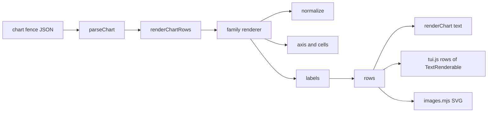
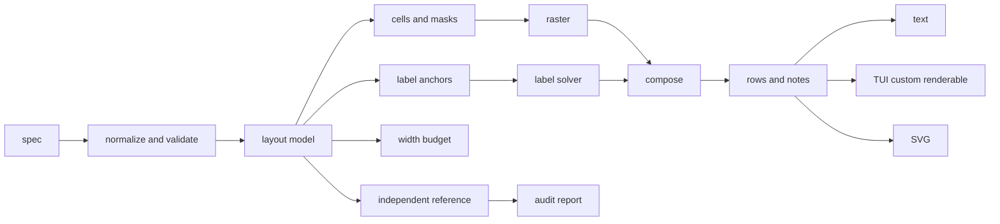

# Pixel-perfect charts

**Status:** draft for review. No code changed.
**Scope:** the 23 chart types in `CHART_TYPES`.
**Thesis:** the charts are closer to pixel perfect than the current tools can show. Pie is already within 0.5% of its true area. The visible failures are labels, width handling, and silent data loss, not the shape math. The first job is to make the measurement honest, then to give every family the same layout, label, and width primitives.

## 1. What "pixel perfect" means here

A terminal cell is not a pixel. Each cell holds a mosaic glyph with 2x2, 2x3, or 2x4 sub-cells. Pixel perfect means the sub-cell geometry, the labels, and the layout meet the rules below. It does not mean anti-aliasing, animation, or a bitmap.

| Level | Pass rule | How we prove it |
|---|---|---|
| Data fidelity | Every input value is drawn, or listed in a note with a count. No silent drop. | Input values equal drawn values plus noted omissions. |
| Geometry | Drawn occupancy matches an independent reference within 0.5 sub-cell. Cell aspect is correct. No systematic bias. | Fidelity script compares the render against a formula, not against the renderer. |
| Labels | Every label is anchored to its mark, inside the chart, not clipped, not overlapping another label, and not covering another series. The last axis label is present or has a stated reason. | Label boxes and anchors are checked as rectangles. |
| Typography | Layout uses terminal display width. CJK, emoji, combining marks, and zero-width joiners do not shift cells. | Width tests with wide and combining strings. |
| Layout | Every row fits the declared width. The declared width fits the content box. A narrow chart degrades in a fixed order and says what it dropped. | Width invariant on every row of every audit case. |
| Colour | Text meets WCAG 4.5:1 against its background, or 3:1 for large text. The chart background matches the cell background so edge cells do not show a halo. | Contrast checker and light/dark frames. |
| Behaviour | Invalid input creates a note, not a crash. The same spec renders the same bytes. | Corpus of bad input and a determinism check. |
| Performance | No unbounded spread, recursion, or series length. A 10k-point sparkline renders in bounded time. | Timing checks with large inputs. |

Out of scope: new chart types, animation, interactivity, web rendering, and bitmap output. The target is the terminal and the SVG mirror.

## 2. Baseline

### 2.1 The accuracy script lies

`scripts/accuracy.mjs` uses a 44x22 chart, margin 1, `radiusX=21`, `radiusY=10.5`, and an ideal area of 692.7 cells. `layoutPie` caps `radiusX` at `height - 2`, which is 20 at this height. The true radii are 20 and 10, and the true ideal is 628.3 cells.

| Mosaic | Script error | True error |
|---|---:|---:|
| Quadrant | -9.8% | -0.5% |
| Sextant | -9.5% | -0.25% |
| Octant | -9.3% | -0.05% |

The error is in the reference, not the renderer. A 9.3% error is larger than every real geometry error found in this audit. Fix the reference before optimizing any shape, or the work will chase a defect that does not exist.

The wedge-boundary and rim-glyph metrics in the script are valid. Keep them.

### 2.2 Confirmed defects

These are measured or read from source. Nothing is fixed.

| Case | Result | Severity | Cause |
|---|---|---|---|
| Sankey 2-node cycle | Crash: `Cannot read properties of undefined (reading 'sort')` at `src/sankey.js:126` | Blocker | Layering assumes a DAG; no cycle check |
| Table, 8 columns at width 16 | Every row is 46 cells | Blocker | `MIN_WIDTH=4` per column; no final overflow rule |
| Table, negative bar values | `-5` and `-10` draw empty bars | High | Bar length uses `value / span`, not `(value - low) / span` |
| Table, 9-digit heat value | Text breaks a 4-wide heat column | High | `exact(value).padStart()` never truncates |
| Heatmap, ragged row | 2 headers, 5 body cells | High | Each row uses its own value count |
| Heatmap, short row | 4 headers, 1 body cell; 3 cells missing | High | Missing values are not padded or noted |
| Kanban, width 24, 3 columns | Third column clipped, card lost | High | `MIN_COLUMN=10` beats the width budget |
| Gauge, width 16, value 123456789 | Row is 22 cells | High | `valueText` is never clipped |
| Gauge, target 0 | No marker | Medium | `round(0) - 1 = -1` |
| Candle, prices 95 to 120 | Axis 0 to 150; candles use 4 rows | Medium | `zero` defaults on |
| Candle labels | Labels at 2, 12, 22, 32, 39; bodies at 10, 16, 22, 28, 34 | High | `pointLabelRow` without positions |
| Line, Jan to May | May is missing | Medium | Last label is dropped when it does not fit |
| Waterfall, 20 steps at width 16 | Labels only for S0, S7, S13; bars fill 11 columns | High | No positions and no bounds check |
| Waterfall legend at width 16 | 23 cells | Medium | Legend is not clipped |
| Sankey, 8 columns at width 16 | Bars only; no links or labels; off-grid columns | High | Fixed gaps exceed the width |
| Gantt, `height: 4` with 6 tasks | 8 rows | Medium | `height` is ignored |
| Gantt group name, 42 chars | Legend is 42 cells at width 24 | Medium | No truncation |
| Histogram footer at width 16 | 24 cells | Medium | Footer is one unbounded run |
| Sparkline, 50 values at width 16 | One row of 53 cells | High | No downsampling |
| Gantt CJK label | Row widths pass, label is misaligned | Medium | `.length` instead of display width |
| Treemap, 2-row child | Label but no value | Medium | `by - kidTop >= 2` is off by one |
| Pie labels | Can sit on edge cells and overwrite the rim; dropped values are silent | Medium | Placement uses the widest run only |

### 2.3 Why 175 green tests missed this

- Width checks use `cols`, which counts code points, not terminal cells. The core test proves an astral glyph is one code point, not that a CJK glyph is two cells.
- Test labels are short ASCII. The corpus has no CJK, emoji, combining marks, or long labels.
- The smoke test checks rows against the chart width, but the chart width is often the number the renderer declared, not the number the terminal will draw.
- There is no invariant for declared width versus actual runs, no audit corpus for narrow widths, ragged rows, cycles, or huge values.
- The accuracy script uses the wrong reference.
- Gauge and progress have no dedicated suite. Progress only appears in the smoke map.

## 3. Current architecture



Every family does all stages. Each family has its own width math, label math, and clipping. That is why the same defects repeat in candle, waterfall, and line. The plugin also guesses the content width with `renderer.width - 6`, and the schema documents that guess.

## 4. Target architecture



New shared modules:

| Module | Job | Why it is shared |
|---|---|---|
| `src/text.js` | `displayWidth`, `sliceByWidth`, `padByWidth`, `truncateByWidth` | One width rule for every family |
| `src/model.js` | Normalize, validate, and collect notes | One place decides what is dropped and why |
| `src/canvas.js` | Bounds-checked cell writes, owner map, text stamp | No renderer can write off-grid |
| `src/labels.js` | Anchors, priority, collision, truncation, drop reasons | Labels stop being per-family code |
| `src/layout.js` | Axis, budget, degradation order | One width policy |
| `src/fidelity/` | Formula per family | A reference that does not import the renderer |
| `scripts/audit.mjs` | Corpus runner | Every case, every invariant |
| `scripts/golden.mjs` | Frame compare | Visual regressions |
| `scripts/probe.mjs` | TUI frame check | Real content width and resize |

The public API stays `renderChartRows(spec)` and `renderChart(spec)`. The layout model is internal, but tests can import it.

## 5. Measurement system

### 5.1 Independent references

Each family gets a formula in `src/fidelity/`. The formula uses the spec, not the renderer's grid.

| Family | Reference | Tolerance |
|---|---|---|
| Pie, donut | Area `pi * radiusX * radiusY`; wedge angle; donut inner radius | 0.5 sub-cell |
| Bar, column, hbar | Bar area and value-to-axis mapping | 0.5 sub-cell |
| Line, area | Point positions and area under the polyline | 0.5 sub-cell |
| Scatter | Point coordinates | 0.5 sub-cell |
| Histogram | Bin counts and edges | Exact count |
| Candle | Body and wick from open, high, low, close | 0.5 sub-cell |
| Heatmap | Cell count and monotonic colour | Exact count |
| Gauge, progress | Filled fraction of the track | 1 cell |
| Waterfall | Cumulative start and end of every step | 0.5 sub-cell |
| Table | Column widths and bar fraction | 1 cell |
| Radar | Polygon vertices and ring radius | 0.5 sub-cell |
| Treemap | Area proportional to value; child inside parent | 0.5% area |
| Sankey | Flow conservation; node height proportional to flow | 1 cell |
| Kanban | Every card inside its column; no card lost | Exact count |
| Gantt | Day offset, bar length, milestone position | 1 day |

A reference that imports the renderer proves only that the renderer agrees with itself. Keep them separate.

### 5.2 Audit corpus

`test/fixtures/audit/<family>.json` holds the cases. One file per family, plus a shared file for width and typography.

```json
{
  "name": "candle-prices",
  "spec": {
    "type": "candle",
    "width": 40,
    "labels": ["Mon", "Tue"],
    "values": [[95, 100, 94, 99], [99, 102, 97, 98]]
  },
  "invariants": ["width", "no-crash", "labels-anchored"]
}
```

Cases to cover for every family:

- Minimum width, minimum plus one, and widths 20, 40, 56, 80, 120.
- Empty, one value, all equal, all zero, negative values, `NaN`, `Infinity`.
- Long labels, CJK labels, emoji labels, combining marks, zero-width joiners.
- Many categories, many series, many rows, ragged rows.
- Dates across a year, a leap day, and a timezone boundary.
- Duplicate IDs, cycles, self-links, missing nodes, missing values.

### 5.3 Invariants

These are automatic and run on every case.

| Name | Rule |
|---|---|
| `WIDTH` | `displayWidth(row) <= row.width <= spec.width` |
| `BOUNDS` | No cell write outside the grid. The canvas counts rejected writes and the test fails on any. |
| `LABEL-BOX` | Every label box is inside the chart, does not overlap another label box, and does not cover another series. |
| `LAST-LABEL` | The last axis label is drawn, unless a note states why it was dropped. |
| `ACCOUNT` | Input values equal drawn values plus noted omissions. |
| `NO-CRASH` | No exception on any corpus case. |
| `DETERMINISTIC` | The same spec renders the same bytes twice. |
| `GEOMETRY` | The independent reference agrees within tolerance. |

### 5.4 Golden frames

Golden frames lock the visual result. They are text first, then TUI frames.

- Widths: 20, 40, 56, 80, 120.
- Themes: dark and light.
- Mosaics: quadrant, sextant, octant.
- Labels: ASCII, CJK, emoji.
- TUI: a private probe at widths 20 to 160, including a resize.

Store them under `test/golden/<family>/<width>-<theme>-<mosaic>.txt`. A change to a golden file needs a human look at the contact sheet, not a blind update.

### 5.5 Font matrix

The library cannot detect what a font draws. It can state what it tested.

| Font | Quadrant | Sextant | Octant |
|---|---|---|---|
| SF Mono | Check | Check | Check |
| Menlo | Check | Check | Check |
| JetBrains Mono | Check | Check | Check |
| Cascadia Code | Check | Check | Check |
| Fira Code | Check | Check | Check |
| Noto Sans Mono CJK | Check | Check | Check |

Default remains sextant. Octant is opt in. The README and schema must say the same thing. Today the README says octant in two places and the code says sextant.

### 5.6 Accuracy reporting

Fix the reference first. Then report:

- Absolute and relative geometry error per mosaic.
- Label failures: clipped, overlapping, dropped.
- Width failures: rows over budget.
- Data failures: values dropped without a note.

`npm run accuracy` should fail when any tolerance is exceeded. A report that only prints percentages invites the reader to ignore them.

### 5.7 Human review

Three surfaces, one source of truth:

- `review/renders.txt` for the plain text.
- `review/gallery.html` for the SVG view.
- The TUI for the real cell aspect and colour.

Generate a contact sheet at five widths for each release. A human looks at the sheet before the release. The automated checks cannot see a font that draws a box.

## 6. Cross-cutting fixes

### 6.1 Display width

Add `src/text.js`:

- `displayWidth(text)`: East Asian Wide and Fullwidth count 2. Combining marks and zero-width joiners count 0. Emoji sequences count 2. Ambiguous width counts 1. Control characters count 0.
- `sliceByWidth(text, max)`, `padByWidth`, `padStartByWidth`, `truncateByWidth(text, max, ellipsis)`.

Replace every `cols`, `.length`, `.slice`, and `padStart` in layout code. Keep `cols` only as a test helper for code points, or rename it to `codePoints` so no one confuses the two.

Why: one CJK label can shift every following cell. The current width tests cannot see it because they count code points.

### 6.2 Label solver

Add `src/labels.js`. A label request has:

```js
{
  text,
  anchor: { x, y },
  owner: "series-0" | "slice-2" | "axis",
  priority: 0..100,
  maxWidth,
  placement: "centre" | "left" | "right" | "above" | "below"
}
```

The solver:

1. Converts the text to display width and truncates with an ellipsis if needed.
2. Places the label at the anchor, then tries the allowed alternate placements.
3. Rejects a box that crosses the chart edge or another label.
4. Never covers a mark owned by a different series.
5. Keeps the last axis label by clamping it left before the collision check.
6. Returns a placed box or a drop reason.

Use it for axis labels, category labels, candle and waterfall labels, line end labels, pie and radar labels, treemap tile labels, and sankey node labels.

Why: the candle, waterfall, and line defects are the same defect. Per-family fixes will drift again.

### 6.3 Width budget and degradation

Every renderer calls `fit(spec, family, availableWidth)`. It returns the width it will use and the degradation steps it took.

Order of degradation:

1. Drop the legend.
2. Shorten the footer to one note.
3. Truncate labels with an ellipsis.
4. Reduce bar, candle, or point width.
5. Thin categories and add `N omitted` to the footer.
6. Reduce plot height.
7. Show a compact summary panel.

The chart never draws outside its declared width. If the available width is below the family minimum, draw a panel with the title, the counts, and the required width. A broken chart is worse than an honest panel.

Why: table, kanban, sankey, and sparkline currently choose between clipping and overflow. Neither is acceptable.

### 6.4 Height contract

Proposal: `height` means total rows for every family. `plotHeight` means the plot area for bar, line, radar, candle, and waterfall. If `height` is too small for the data, the renderer uses the minimum and adds a note.

Current behaviour:

| Family | `height` means |
|---|---|
| Bar, line, radar, candle, waterfall | Plot rows |
| Treemap, kanban, table | Total rows |
| Gantt | Ignored |
| Pie | Total disc height |

Why: one contract makes the schema true and makes the output predictable. This is a breaking change, so it needs a version note.

### 6.5 Notes

Collect notes in one structured list:

```js
{ code: "dropped-values", count: 2, message: "2 non-positive values omitted" }
```

Rules:

- One line per note in the footer.
- Footer lines use display width and truncate with an ellipsis.
- No migration notes. The heatmap message "headers come from headers now" is a changelog line, not a chart note.
- Every drop, clamp, ragged row, cycle, and omitted category has a note.
- No note when nothing was dropped.

Why: a chart that hides data is lying. A chart that prints a changelog is noisy. The note is the contract between the two.

### 6.6 Contrast and theme

- `contrastOn(fill)` picks the better of `#101010` and `#ffffff` using WCAG relative luminance. It must return the pair with the higher ratio, not a fixed threshold.
- Value labels use `kind: "label"` so they get a background and a contrast foreground.
- A target marker over a filled cell uses the target colour as foreground and the fill as background. It keeps the partial block visible.
- The TUI passes its real background to the theme. Edge cells use that background, not a hard-coded `#0b0b0b`. Otherwise a dark halo appears on a light terminal.
- Keep the library palette for deterministic tests. Allow a `palette` override and a `theme: "auto"` mode that reads the renderer background.

Why: a perfect shape with unreadable text is not perfect. A fixed background is a visible seam on every theme that is not the library's own.

### 6.7 Font coverage

- Default sextant. It has the widest font support.
- Quadrant is the safe fallback for a font that lacks sextants.
- Octant is opt in. It is Unicode 16 and the newest.
- The README, schema, and code must agree. The README currently says octant.
- Add a font matrix to the README with the tested fonts and terminals.
- The renderer cannot detect a missing glyph. The test matrix and the fallback option are the honest answer.

### 6.8 TUI integration

Replace the stack of `TextRenderable` rows with one `ChartRenderable`:

- `setMeasureProvider` returns the intrinsic width and height.
- `renderSelf` writes the styled chunks.
- On resize, call `invalidateIntrinsicSize()` and `requestRender()`.
- Read the real content width from `getLayout()`, not `renderer.width - 6`.
- The chart width is `min(spec.width or contentWidth, contentWidth)`.

Why: the current `-6` is a guess in the schema. It clips at some widths and leaves a gap at others. A row stack also cannot reflow on resize.

### 6.9 Performance and determinism

- Replace `Math.min(...values)` and `Math.max(...values)` with a loop. The spread can overflow the stack on large arrays.
- Downsample sparklines to the plot width. Preserve the first, last, min, and max of each bucket so spikes survive.
- Cap histogram bins, sankey nodes, treemap depth, and radar axes. Add a note when the cap is hit.
- Use stable sorts with an explicit tie breaker. The same values must produce the same order.
- Format numbers without the host locale. `1,234.5` must not become `1.234,5` on a German machine.

Why: a chart that crashes on 10k points or changes order between machines is not deterministic.

## 7. Per-family audit

| Type | What is wrong today | Target | Phase |
|---|---|---|---|
| `pie` | Labels can sit on edge cells and overwrite the rim. Non-positive values are dropped without a note. | Label solver with inside, outside, or legend fallback. Note every drop. | P1, P3 |
| `donut` | Same as pie. The inner radius reduces label space. | Same. Add donut label tests. | P1, P3 |
| `bar` | Identical to `column`. Value text is series-coloured with no background. `height` is plot rows. | Keep the alias or document it. Value labels use contrast. Total height contract. | P1 |
| `column` | Same as `bar`. | Same. | P1 |
| `hbar` | Label truncation is code-point based. The percent contract is contradictory. Narrow widths clip. | Display width. One `showPercent` contract. Width budget. | P1 |
| `histogram` | Footer overflows. Only left bin edges are labelled. Spread on large arrays. | Fit the footer. Show ranges when they fit. Loop for min and max. | P1 |
| `candle` | Zero axis by default. Labels do not align with bodies. `ohlc` is an alias. | Zero off by default. Anchor labels to candle centres. Separate OHLC. | P1 |
| `candlestick` | Same as candle. | Same. | P1 |
| `ohlc` | Draws filled candles, not open-high-low-close ticks. | Own renderer with ticks, or remove the type. | P1 |
| `line` | Last label is dropped. End labels can overwrite another series. | Clamp the last label. Reserve a right gutter for end labels. | P1, P3 |
| `area` | Same as line. Fill to zero is correct but the zero row can swallow small values. | Same, plus a zero-row check. | P1 |
| `sparkline` | No downsampling. 50 values draw 53 cells at width 16. | Min and max buckets, preserve first and last. | P1 |
| `scatter` | Points are 2 cells wide. X labels are thinned without a rule. | Budget points and labels. State the thinning. | P1 |
| `heatmap` | Ragged rows disagree with headers. Header slice is UTF-16. `NaN` becomes 0. | Rectangular matrix. Display width. Note bad values. | P1 |
| `gauge` | Value text overflows. Target 0 has no marker. Target above max is not noted. | Compact value. Clamp the marker. Note the range. | P1 |
| `progress` | Same renderer as gauge. No dedicated suite. | Add tests. Apply the same fixes. | P1 |
| `waterfall` | Labels do not align with bars. Legend overflows. Grid writes are not bounds checked. | Anchor labels. Clip the legend. Bounds check. Summary at narrow widths. | P1 |
| `table` | 8 columns at width 16 draw 46 cells. Negative bars are empty. Long heat text breaks the column. | Final fit. Diverging bars with the true range. Compact numbers. | P1 |
| `radar` | Negative values are clamped without a note. Labels collide. Overlapping series hide each other. | Note clamps. Label solver. Series patterns or a note. | P1, P3 |
| `treemap` | A 2-row child gets a label but no value. Small groups lose children. Rounding loses area. | One-line label plus value when needed. Group fallback. Cell ownership. | P1 |
| `sankey` | Cycle crash. Fixed gaps exceed the width. Labels are skipped. Links are dropped silently. | Cycle detection. Fit the columns. Label fallback. Notes. | P0, P1 |
| `kanban` | `MIN_COLUMN=10` clips the third column at width 24. `height` is total. Wide labels use code points. | Dynamic minimum. Stack columns when needed. Display width. | P1 |
| `gantt` | `height` is ignored. `.length` misaligns CJK labels. Legend overflows. Numeric domains include 0. | Height contract. Display width. Clip the legend. Fix the domain. | P1 |

Shared defects behind the table:

- Every family counts code points. One display-width module fixes all of them.
- Every family places labels with its own math. One solver fixes all of them.
- Every family has a different `height` contract. One contract fixes all of them.
- Every family can drop data without a note. One note list fixes all of them.
- Every family chooses between clipping and overflow at narrow widths. One budget fixes all of them.

## 8. Phases

| Phase | Work | Why | Exit criteria |
|---|---|---|---|
| P0. Truth and crashes | Fix the accuracy reference. Detect sankey cycles. Add the audit corpus and the width and bounds invariants. Record the display-width failures in the corpus. | Every later fix is measured against a lie, and a crash loses the whole chart. | Accuracy is true. No corpus case crashes. The 23 canonical samples and the sankey cycle case pass `WIDTH` and `BOUNDS`; the known edge-case failures stay listed for P1. |
| P1. Keep data on screen | Fix table, kanban, gauge, heatmap, sparkline, treemap, gantt, last label, candle labels, waterfall. | These cases lose data, overflow the chart, or draw outside it. Correctness comes before beauty. | Every P1 corpus case is green. |
| P2. Typography | Add `src/text.js`. Replace every code-point width, slice, pad, and truncate. Add CJK, emoji, and combining tests. | One CJK label can shift every cell after it. The current tests cannot see it. | Wide and combining cases pass on every family. |
| P3. Label solver | Add `src/labels.js`. Move axis, candle, waterfall, line end, pie, radar, treemap, and sankey labels onto it. | The visible label defects are one defect repeated in six families. | No clipped, overlapping, or unanchored label in the corpus. |
| P4. Geometry | Add independent references. Fix zero defaults, aspect, pie label runs, radar polygons, sankey flows, treemap areas. | Pixel perfect needs a proof, not a screenshot. | Every family is within tolerance of its reference. |
| P5. TUI layout | Replace the row stack with one `ChartRenderable`. Use the real content width. Re-render on resize. Update the schema. | The `-6` guess clips or leaves a gap. A row stack cannot reflow. | The probe passes at widths 20 to 160 and after a resize. |
| P6. Colour | Fix contrast, value-label backgrounds, target-over-fill, and the real terminal background. | A correct shape with unreadable text is not perfect. | Dark and light frames pass the contrast check. |
| P7. Lock it | Golden frames, font matrix, contact sheet, docs, release notes. | Without a lock, the defects return. | Golden suite green, font matrix published, docs agree with code. |

P0 and P1 are the minimum useful release. P2 to P7 can follow in order. Do not start P4 before P0, because the reference is wrong.

## 9. Test matrix

| Gate | Command | What it proves |
|---|---|---|
| Unit and property | `npm test` | Existing family behaviour and new primitives |
| Audit | `npm run audit` | Width, bounds, labels, data accounting, no crash |
| Fidelity | `npm run fidelity` | Geometry against independent references |
| Golden | `npm run golden` | Visual frames at five widths, two themes, three mosaics |
| TUI probe | `npm run probe:tui` | Real content width, resize, chunk packing |
| Accuracy | `npm run accuracy` | Pie area and rim metrics |
| Gallery | `npm run gallery` | Human contact sheet |
| Performance | `npm run perf` | 10k-point sparkline, 1k-row table, 100-node sankey |

CI runs `npm test`, `npm run audit`, `npm run fidelity`, and `npm run golden`. The TUI probe runs before a release. The contact sheet is a human gate.

## 10. Decisions

Settled on 2026-10-25:

1. `height` means total rows for every family. `plotHeight` covers the plot area.
2. `bar` stays an alias of `column`. `hbar` stays the horizontal type.
3. `ohlc` gets a true open-high-low-close renderer.

The other four remain recommendations.

| # | Decision | Options | Recommendation | Why |
|---|---|---|---|---|
| 1 | `height` contract | Total rows for all, or keep per family | Total rows, plus `plotHeight` for plot-only families | One rule makes the schema true and the output predictable. The current mix is a bug source. |
| 2 | `bar` versus `column` | Keep `bar` as an alias, or make `bar` horizontal | Keep the alias and document it. `hbar` stays the horizontal type. | Changing `bar` breaks existing fences for no visual gain. A real change needs a major version. |
| 3 | `ohlc` | Implement ticks, or remove the type | Implement open-high-low-close ticks | The name is a promise. A filled candle with an OHLC label is a lie. |
| 4 | Percent option | `percent`, `showPercent`, or both | `showPercent` with `percent` as a deprecated alias | The schema and README already advertise `showPercent`. The code reads `percent`. One contract. |
| 5 | Theme source | Library palette only, or the OpenCode theme | Library palette plus an override. Pass the real terminal background. | Tests need a fixed palette. Users need the chart to sit on their background without a halo. |
| 6 | Default mosaic | Sextant or octant | Sextant, with octant opt in | Sextant has wider font support. The README currently says octant, which is wrong. |
| 7 | First release scope | P0 and P1, or all phases | P0 and P1, then re-audit | The corpus will find more cases. Fix the lying metric and the data loss first. |

Decisions 1, 2, and 3 are settled. Decisions 4 to 7 can be applied as recommended, unless you want a different contract.

## 11. Risks and non-goals

Risks:

- Fonts vary. The library can guarantee layout, not that the font draws every glyph. The matrix and the sextant default are the mitigation.
- The height and percent changes break existing fences. Ship them with a version note and a compatibility alias.
- Golden frames create churn. A changed frame needs a human look, not a blind `--update`.
- The audit corpus grows. Keep one file per family and a shared width file. Review it like code.
- Performance work can change the picture. Every downsample or cap needs a note and a fidelity check.

Non-goals:

- New chart types.
- Animation or interaction.
- Bitmap or PDF output.
- A general layout engine for non-chart content.
- Detecting every terminal font at runtime.

"Pixel perfect" is bounded by the cell and the font. We can guarantee the geometry, the labels, the width, and the data. We cannot guarantee that a specific font has a specific mosaic glyph. Say that in the README instead of promising more.

## 12. Appendix

### Files to add

| File | Purpose |
|---|---|
| `src/text.js` | Display width, slice, pad, truncate |
| `src/canvas.js` | Bounds-checked grid, owner map, text stamp |
| `src/labels.js` | Label solver |
| `src/layout.js` | Axis, budget, degradation |
| `src/model.js` | Normalize, validate, notes |
| `src/fidelity/*.mjs` | One reference per family |
| `scripts/audit.mjs` | Corpus runner |
| `scripts/fidelity.mjs` | Reference comparison |
| `scripts/golden.mjs` | Frame compare |
| `scripts/probe.mjs` | TUI width and resize probe |
| `scripts/perf.mjs` | Large-input timing |
| `test/fixtures/audit/*.json` | Audit cases |
| `test/golden/**` | Golden frames |

### Files to change

| File | Change |
|---|---|
| `src/axis.js` | Use display width. Clamp the last label. Use the label solver. |
| `src/core.js` | Replace code-point width helpers. Add the canvas. |
| `src/chart.js` | Structured notes. Remove migration notes. Family registry stays. |
| `src/theme.js` | WCAG contrast. Real background. Value-label kind. |
| `tui.js` | `ChartRenderable`, real content width, resize. |
| `schema/chart.schema.json` | Height, width, percent, mosaic defaults. |
| `README.md` | Height, mosaic, ohlc, bar and column, font matrix. |
| `skills/opencode-charts/SKILL.md` | Same contract as the schema. |
| `scripts/accuracy.mjs` | Correct reference. Fail on tolerance. |

### Commands

```sh
npm test
npm run accuracy
npm run audit
npm run fidelity
npm run golden
npm run probe:tui
npm run gallery
npm run perf
```

### Audit case shape

```json
{
  "name": "table-negative-bar",
  "spec": {
    "type": "table",
    "width": 20,
    "columns": [
      { "label": "Account" },
      { "label": "Delta", "type": "bar" }
    ],
    "rows": [["A", -5], ["B", 10]]
  },
  "invariants": ["width", "bounds", "no-crash", "data-accounting"]
}
```

### Glossary

- **Cell:** one terminal character position.
- **Sub-cell:** one cell of the 2x2, 2x3, or 2x4 mosaic inside a terminal cell.
- **Display width:** the number of terminal cells a grapheme occupies.
- **Owner:** the series or slice that owns a cell.
- **Anchor:** the point a label is attached to.
- **Budget:** the width left after axis, labels, legend, and margins.
- **Degradation:** the documented order in which a chart gives up detail to fit.
- **Fidelity:** agreement between the render and an independent formula.

---

## 13. Status (2026-10-25)

P0 to P7 are implemented. The per-family rows below are closed.

- **P0 truth:** the accuracy reference uses the radius the layout really uses. The pie is 0.5% from the analytic area, not 9.3%. The sankey cycle guard draws the graph and names the edge. `npm run audit` has 42 cases: 19 corpus cases plus one height case for every family.
- **P1 data and width:** table, heatmap, kanban, gauge, candle, waterfall, line, sparkline, treemap, gantt and histogram keep their data on screen or say what they hid. `height` is total rows for every family. `plotHeight` sets the plot area. `showPercent` is canonical; `percent` still draws with a note.
- **P2 typography:** `src/text.js` measures grapheme clusters in terminal cells. Labels, padding and wrapping use display width.
- **P3 labels:** the last axis label is kept. Candle and waterfall labels centre on their marks. Pie and radar labels collide, shift, shorten, then drop with a note. End labels do not overwrite another series. Sankey fits its columns at narrow widths and names hidden links and labels.
- **P4 fidelity:** `npm run fidelity` has 26 checks and covers every family. `npm run golden` compares 954 frames: 690 family frames across 5 widths, 2 themes and 3 mosaic modes, plus 264 variant frames for grouped/stacked series, narrow widths and tight heights.
- **P5 layout:** one `ChartRenderable` owns its cells, measures itself and re-renders on resize. The standalone OpenTUI probe passed at 56 and 40 columns.
- **P6 colour:** WCAG contrast picks the text colour. Labels carry a background; horizontal bar values sit on the chart background, not on a second series block. A target on a partial bar keeps the partial glyph. The theme has a foreground.
- **P7 lock:** `npm test` is 460 checks in 23 suites. `npm run audit` is 42/42, `npm run fidelity` is 26/26, `npm run golden` is 954/954, `npm run perf` holds every family under budget, and the light theme is checked by eye in `review/gallery-light.html`.

Still open:

- Three chart defects found while refactoring, each needing its own test and a golden update because the fix changes the picture. See §14.
- `npm run probe:tui` skips on Node 24 because OpenTUI needs bun or Node 26.4 or newer. The standalone OpenCode probe passed on this machine.
- Octant font coverage is still a terminal assumption. Sextant is the default; octant is opt in.
- The light theme is checked by eye in the SVG gallery, not on a physical light terminal.

## 14. Code quality (2026-10-26)

`crapper` reports **no function at or above CRAP 10**. The worst is 9.4 (`renderGanttRows`, 83.3% covered). The campaign split about 60 functions across 20 modules into helpers of CC <= 5. The refactor itself was pinned byte-identical by the 690 family frames and per-family differentials; the defects listed below were then fixed on purpose, with new tests and a widened golden corpus.

The design rule that came out of it: **CC <= 5**, not CC <= 9. CRAP = CC^2 * (1-cov)^3 + CC, so a CC 10 function can never score below 10 at any coverage, and CC 9 needs 77% coverage to pass. CC 5 clears the bar down to 42% coverage.

Defects found by the refactor and the independent review, now fixed with tests:

1. **Grouped bars floated.** `stackRanges` built running totals even when not stacked, so a second series drew from the first series' total upward. Non-stacked now spans `0 → value`.
2. **Stacked area drew a floating band.** Band 0's floor was the scalar `0` where a per-column array was expected, so `valueAt` returned `NaN` and the bottom band never painted. A one-series stacked area drew nothing at all. Fixed, and the blind check that asserted the inverted order was replaced.
3. **Table heat columns ignored explicit bounds.** `describedColumn` never copied `low`/`high`. Now resolved as `column.low ?? spec.low ?? theme.heat.low`.
4. **A missing table number cell printed `0`.** Blank now renders blank, with no phantom bar or heat paint.
5. **The footer lied about numeric strings.** `"12"` was drawn as 12 and reported as "treated as 0". Bad values are now `Number()`-tested, and the verb matches what the family does (dropped vs zero-filled).
6. **A string `gap` broke kanban.** The colour alias was renamed but left in place, so `Math.floor("#333")` made a NaN gap and hid a column. It is now removed after the rename, and numbers pass through.
7. **Kanban note over a card.** The overflow note is written over the last card's border when a card ends on the final row, and a later small card could jump a dropped one. The note now gets its own row and cards stop at the first that does not fit.
8. **`metaLines: 0` still showed meta.** Zero now means zero.
9. **Candle and OHLC lost data silently.** A row with a missing price and periods past the right edge both disappeared with no note. Both now report skipped rows and hidden periods, and the notes are counted in the height budget.
10. **Radar clipped values above `max` silently.** It now reports `N values above max clipped to <max>` and reserves the row.
11. **A render error could escape the plugin.** An unknown mosaic name or a non-array `labels` threw inside the TUI measure callback, outside the constructor's `try`. Unknown modes fall back to sextant, `ensureRows` turns any failure into a `chart: <reason>` row, a non-finite width becomes 160, and rows are clipped to the measured box.

Two review claims did not hold and were not "fixed": duplicate kanban `order` entries do not emit two columns (the board reports `no data` when `order` has no matching columns), and the heat colour path always read `column.low` — the bug was that nothing copied it.

A third review pass found five more, all verified and fixed:

12. **The old `gap` colour was announced but never applied.** `themeFor` in `tui.js` reads the raw spec, and the rename happens later on a copy, so `"gap": "#333"` printed the note and drew the default boundary. `themeFor` now accepts the old key.
13. **A wrong `--family` name passed.** `node scripts/golden.mjs --family pie_` matched nothing and exited 0. It now fails with `unknown family`.
14. **Histogram `data` was dropped without a note.** `valueLists` did not include `spec.data`, so `{"data":[1,"x"]}` lost `"x"` silently.
15. **OHLC had its own plot-row rule.** `height: 0` gave OHLC 3 plot rows and candle 10, and `plotHeight: 0` was honoured by one and ignored by the other. OHLC now uses `layout.plotRows` like candle.
16. **Scatter points vanished or moved silently.** An object point became "no data" with no note, and `["Jan", 5]` became x=0. Both are now counted as `N point(s) skipped`, and an explicit `cellAspect` option now beats the terminal's measured aspect, because the option exists for terminals that report it wrong.

