# opencode-chart-tui

**23 chart families, drawn inside the OpenCode terminal from a fenced code block.**

You type a ```chart fence with a JSON body; the plugin draws it in place — pie, donut, bar, line, area, scatter, histogram, candlestick, waterfall, heat map, gauge, radar, treemap, sankey, kanban — in colour, at sub-cell resolution, on your terminal's own theme.

Nothing is rendered as an image: every family paints a grid of cells, so the geometry is testable without a terminal and the picture fits any pane.

## Gallery

Every picture is that family's own output, drawn from the library itself rather than
made by hand: `node scripts/images.mjs` renders each sample and turns the mosaic and
block glyphs into rectangles, so the shapes are exact and cannot drift from the code.

GitHub does not know the `chart` language, so the fence bodies below show as plain
text here. Paste one into OpenCode and it renders.

| | |
|---|---|
| 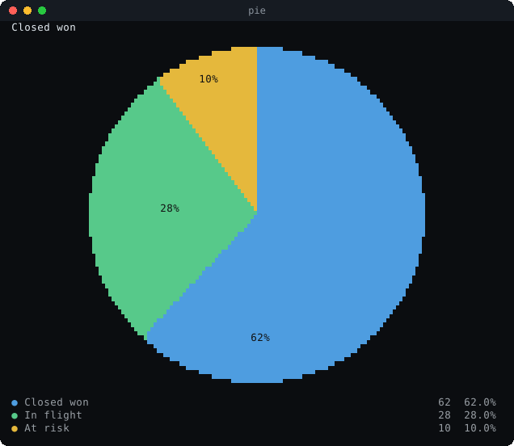 | 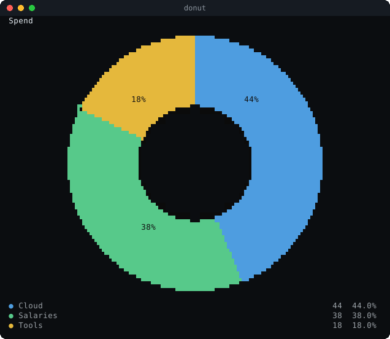 |
| 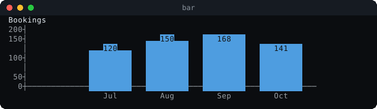 | 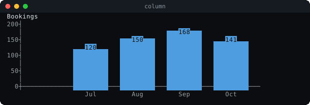 |
| 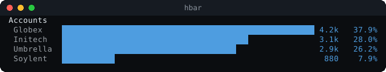 | 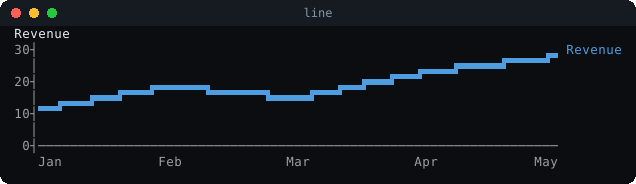 |
| 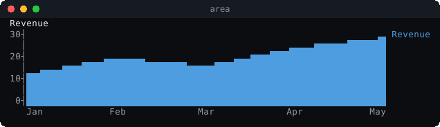 | 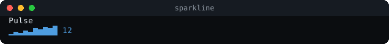 |
| 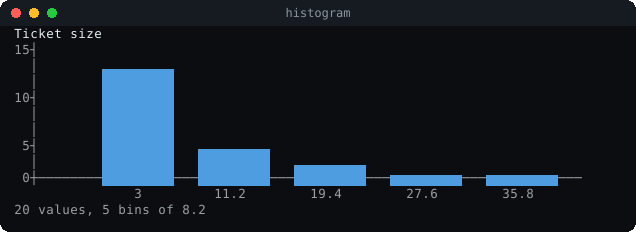 | 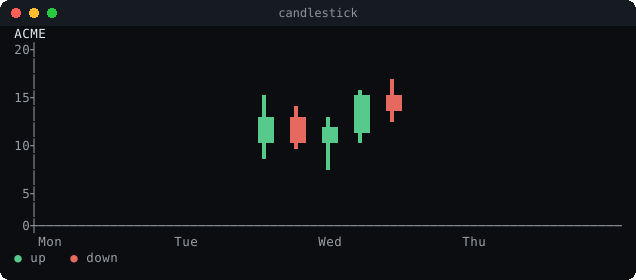 |
| 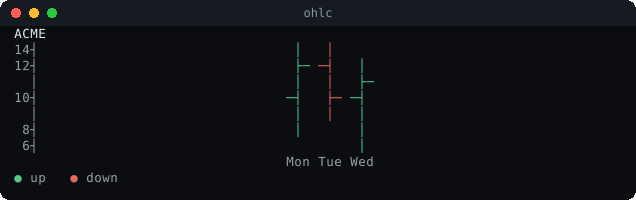 | 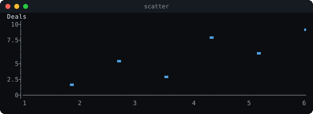 |
| 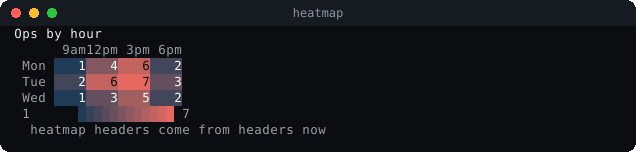 | 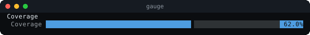 |
| 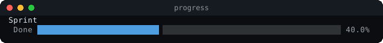 | 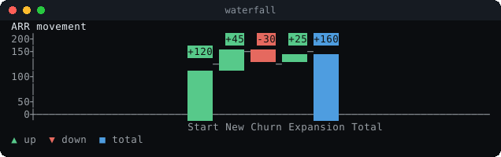 |
| 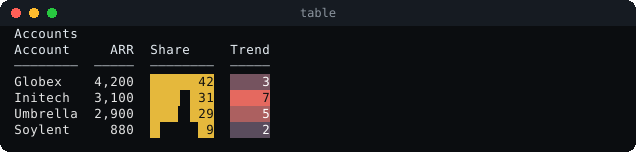 | 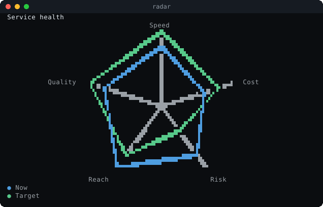 |
| 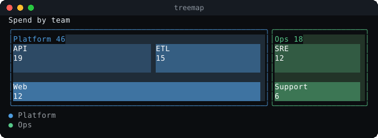 | 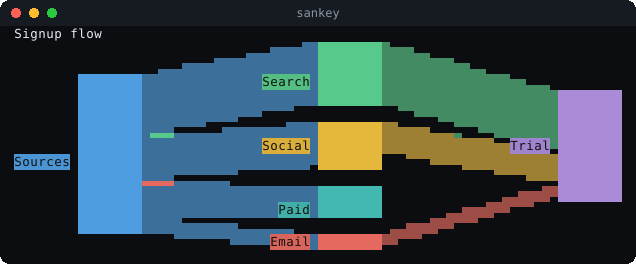 |
| 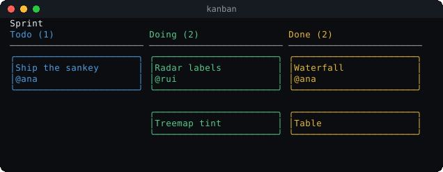 | 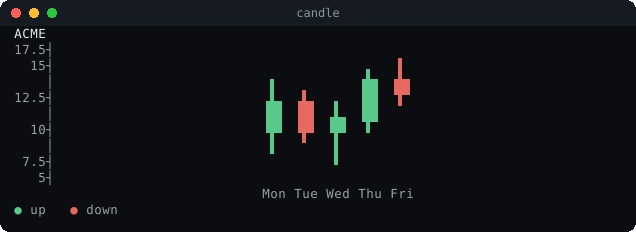 |
| 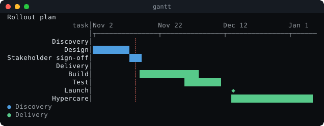 |  |

<details>
<summary><b>Every fence, ready to paste</b></summary>

**`pie`**

```chart
{"type":"pie","title":"Closed won","labels":["Closed won","In flight","At risk"],"values":[62,28,10]}
```

**`donut`**

```chart
{"type":"donut","title":"Spend","labels":["Cloud","Salaries","Tools"],"values":[44,38,18],"donut":true}
```

**`bar`**

```chart
{"type":"bar","title":"Bookings","labels":["Jul","Aug","Sep","Oct"],"values":[120,150,168,141],"height":9}
```

**`column`**

```chart
{"type":"column","title":"Bookings","labels":["Jul","Aug","Sep","Oct"],"values":[120,150,168,141],"height":9}
```

**`hbar`**

```chart
{"type":"hbar","title":"Accounts","labels":["Globex","Initech","Umbrella","Soylent"],"values":[4200,3100,2900,880]}
```

**`line`**

```chart
{"type":"line","title":"Revenue","labels":["Jan","Feb","Mar","Apr","May"],"series":[{"name":"Revenue","values":[12,18,15,22,26]}],"height":9}
```

**`area`**

```chart
{"type":"area","title":"Revenue","labels":["Jan","Feb","Mar","Apr","May"],"series":[{"name":"Revenue","values":[12,18,15,22,26]}],"height":9}
```

**`sparkline`**

```chart
{"type":"sparkline","title":"Pulse","values":[3,5,4,7,6,9,8,11,10,12]}
```

**`histogram`**

```chart
{"type":"histogram","title":"Ticket size","values":[3,5,5,6,7,7,8,8,9,9,10,11,12,13,15,18,22,26,31,44],"height":9}
```

**`candlestick`**

```chart
{"type":"candlestick","title":"ACME","labels":["Mon","Tue","Wed","Thu","Fri"],"values":[[10,14,8,12],[12,13,9,10],[10,12,7,11],[11,15,10,14],[14,16,12,13]],"height":12}
```

**`ohlc`**

```chart
{"type":"ohlc","title":"ACME","labels":["Mon","Tue","Wed"],"values":[[10,14,8,12],[12,13,9,10],[10,12,7,11]],"height":10}
```

**`scatter`**

```chart
{"type":"scatter","title":"Deals","points":[[1,2],[2,5],[3,3],[4,8],[5,6],[6,9]],"height":10}
```

**`heatmap`**

```chart
{"type":"heatmap","title":"Ops by hour","columns":["9am","12pm","3pm","6pm"],"rows":[{"label":"Mon","values":[1,4,6,2]},{"label":"Tue","values":[2,6,7,3]},{"label":"Wed","values":[1,3,5,2]}],"cellWidth":4}
```

**`gauge`**

```chart
{"type":"gauge","title":"Coverage","label":"Coverage","value":62,"max":100}
```

**`progress`**

```chart
{"type":"progress","title":"Sprint","label":"Done","value":0.4,"max":1}
```

**`waterfall`**

```chart
{"type":"waterfall","title":"ARR movement","labels":["Start","New","Churn","Expansion"],"values":[120,45,-30,25],"height":10}
```

**`table`**

```chart
{"type":"table","title":"Accounts","columns":[{"label":"Account"},{"label":"ARR","type":"number"},{"label":"Share","type":"bar"},{"label":"Trend","type":"heat"}],"rows":[["Globex",4200,42,3],["Initech",3100,31,7],["Umbrella",2900,29,5],["Soylent",880,9,2]]}
```

**`radar`**

```chart
{"type":"radar","title":"Service health","labels":["Speed","Cost","Risk","Reach","Quality"],"series":[{"name":"Now","values":[4,3,4,5,4]},{"name":"Target","values":[5,4,2,4,5]}],"height":20}
```

**`treemap`**

```chart
{"type":"treemap","title":"Spend by team","height":12,"items":[{"label":"Platform","children":[{"label":"API","value":19},{"label":"ETL","value":15},{"label":"Web","value":12}]},{"label":"Ops","children":[{"label":"SRE","value":12},{"label":"Support","value":6}]}]}
```

**`sankey`**

```chart
{"type":"sankey","title":"Signup flow","height":14,"nodes":[{"id":"sources","label":"Sources"},{"id":"search","label":"Search"},{"id":"social","label":"Social"},{"id":"email","label":"Email"},{"id":"trial","label":"Trial"},{"id":"paid","label":"Paid"}],"links":[{"from":"sources","to":"search","value":14},{"from":"sources","to":"social","value":10},{"from":"sources","to":"email","value":4},{"from":"sources","to":"paid","value":8},{"from":"search","to":"trial","value":14},{"from":"social","to":"trial","value":7},{"from":"email","to":"trial","value":3}]}
```

**`kanban`**

```chart
{"type":"kanban","title":"Sprint","height":12,"columns":[{"title":"Todo","cards":[{"title":"Ship the sankey","meta":"@ana"}]},{"title":"Doing","cards":[{"title":"Radar labels","meta":"@rui"},{"title":"Treemap tint"}]},{"title":"Done","cards":[{"title":"Waterfall","meta":"@ana"},{"title":"Table"}]}]}
```

**`candle`**

```chart
{"type":"candle","title":"ACME","labels":["Mon","Tue","Wed","Thu","Fri"],"candles":[{"open":10,"high":14,"low":8,"close":12},{"open":12,"high":13,"low":9,"close":10},{"open":10,"high":12,"low":7,"close":11},{"open":11,"high":15,"low":10,"close":14},{"open":14,"high":16,"low":12,"close":13}],"height":12}
```

**`gantt`**

```chart
{"type":"gantt","title":"Rollout plan","height":11,"today":"2026-11-14","tasks":[{"label":"Design","group":"Discovery","start":"2026-11-02","end":"2026-11-13"},{"label":"Stakeholder sign-off","group":"Discovery","start":"2026-11-13","end":"2026-11-17"},{"label":"Build","group":"Delivery","start":"2026-11-16","end":"2026-12-04"},{"label":"Test","group":"Delivery","start":"2026-11-30","end":"2026-12-11"},{"label":"Launch","group":"Delivery","at":"2026-12-14","milestone":true},{"label":"Hypercare","group":"Delivery","start":"2026-12-14","end":"2027-01-08"}]}
```

</details>

## Install

It is a native OpenCode plugin. One command installs it:

```sh
opencode plugin add acastro2/opencode-chart-tui
```

`plugin add` fetches the package from the git repo, installs it, and pins
`"acastro2/opencode-chart-tui"` in `opencode.json` under `plugins`; the CLI loads
its TUI component automatically. Restart the TUI once (plugins load at startup).
Later, `opencode plugin update` refreshes it.

<details>
<summary><b>Other ways to load it, if you need them</b></summary>

- **Discovery, no config entry.** OpenCode discovers any directory under `~/.config/opencode/plugins/` that holds a `tui.js`:

```sh
git clone https://github.com/acastro2/opencode-chart-tui ~/.config/opencode/plugins/opencode-chart-tui
```

- **Developing it?** Keep your checkout where it is and point a discovery directory at it:

```sh
ln -s ~/Developer/opencode-charts ~/.config/opencode/plugins/opencode-chart-tui
```

`src/` edits are live at the next render; a `tui.js` edit needs a restart.

- **CLI-only.** `cli.json` → `plugins` takes an npm id (`pkg`, `pkg@1.0.0`, `@scope/pkg`), a relative or absolute path, or a `file://` URL; the object form `{ "package": "…", "options": { … } }` passes options. Use it for a plugin that must stay active with a remote server, or when you want the entry in one file.
- **No dependencies of its own.** `@opentui/core` and the OpenCode plugin API resolve from the host at runtime, so nothing is installed beside the package.

</details>

## Use

A fence whose language is `chart`. The body is JSON — comments and trailing commas are allowed.

````markdown
```chart
{
  "type": "pie",
  "title": "Pipeline",
  "slices": [["Closed won", 62], ["In flight", 28], ["At risk", 10]]
}
```
````

Press nothing, run nothing: the fence is replaced by the drawing as soon as it is rendered. A body that cannot be read shows `chart: <reason>` and the fence itself, so a broken chart is never silent. Anything the chart had to change — a guessed type, an old key name, a value that was not a number — is printed under it in a muted footer.

### The families

| type | data | notes |
|---|---|---|
| `pie`, `donut` | `slices: [[label, value]]`, or `labels` + `values` | `mosaic` sets the rim resolution |
| `bar`, `column` | `labels`, `values` or `series: [{name, values}]` | `stacked`, `normalized` (100%), `showPercent` |
| `hbar` | the same | `sort`, `track` |
| `line`, `area` | `labels`, `values` or `series` | `stacked`, `normalized`, `zero: false` for a narrow range |
| `scatter` | `points: [[x, y]]` | `big` doubles the marker |
| `sparkline` | `values` | one row |
| `histogram` | `values: [numbers]` | `bins`, square-root rule by default |
| `candle`, `candlestick` | `candles: [{open, high, low, close}]` or `values: [[o, h, l, c]]` | `up` / `down` colours |
| `ohlc` | the same data | drawn as candles |
| `heatmap` | `headers`, `rows: [{label, values}]` | `cellWidth`, `low`, `high`, `valueLabels` |
| `gauge`, `progress` | `value`, `max` | `target` draws a marker |
| `waterfall` | `values` (deltas), `labels` | `start`, `total: false`, `totalLabel` |
| `table` | `columns: [{label, type}]`, `rows` | types `text`, `number`, `bar`, `heat` |
| `radar` | `labels` (axes), `values` or `series` | `max`, `spokes: false`, `filled` |
| `treemap` | `items: [{label, value, children}]` | groups hold their children as bands |
| `sankey` | `nodes`, `links: [{from, to, value}]` | columns declared or layered from the links |
| `kanban` | `columns: [{title, cards}]` or a flat `cards` list | `columnWidth`, `order` |
| `gantt` | `tasks: [{label, start, end, group, milestone}]` | `start`/`end` take numbers or ISO dates, `at` is a milestone, `today` draws the line |

Shared keys: `title`, `width`, `height`, `theme` (`dark` | `light`), `palette`, `legend`, `mosaic` (`sextant` default, `octant` for Unicode 16 fonts, `quadrant` for the widest support), `textured`, `boundaryColor`.

The full contract, with a description of every key, is [`schema/chart.schema.json`](schema/chart.schema.json).

## How it draws

Three ideas do the work.

1. **Cells are not square.** A terminal cell is about twice as tall as it is wide, so a circle is drawn on an ellipse in cell coordinates (vertical radius = half the horizontal) and every shape is corrected the same way. Without it a pie is a tall oval.
2. **A cell is a mosaic.** Each cell is sampled as a 2×2, 2×3 or 2×4 grid of sub-cells and the resulting mask picks a Unicode mosaic glyph (`▖▝🬭𜴏`), so rims and band edges follow the curve instead of stair-stepping. Three character sets are supported: quadrant (Unicode 1.0, everywhere), sextant (Unicode 13, the default) and octant (Unicode 16, the sharpest).
3. **A boundary cell carries both series.** Where a boundary crosses a cell, the glyph holds the winning series' sub-cells and the cell's background holds the other, so the boundary costs no extra cell and lands on the sub-cell curve. The same trick draws a spoke over a filled radar.

Every family renders from a grid of cells, with plain text and styled runs as two renderings of the same layout — which is why there are tests for geometry and none for colour matching.

## The library

`src/` is dependency-free ES modules, usable without OpenCode:

```js
import { renderChart, renderChartRows, chartTypes } from "./src/chart.js";

renderChart({ type: "bar", labels: ["a", "b"], values: [3, 5] });      // plain text
renderChartRows({ type: "bar", labels: ["a", "b"], values: [3, 5] });  // rows of runs, for a renderer
```

| | |
|---|---|
| `core.js` | cells, runs, the sub-cell sampler, legends, perceptual colour mixes, wrapping |
| `theme.js` | dark and light palettes, muted tones, `styleOf(run)` → colours and background |
| `mosaic.js` | quadrant, sextant and octant glyph tables, generated from UnicodeData.txt |
| `axis.js` | nice bounds, the box-model axis, tick rows, label rows |
| `pie.js` `bar.js` `line.js` `heatmap.js` `gauge.js` `histogram.js` `candle.js` `waterfall.js` `table.js` `radar.js` `treemap.js` `sankey.js` `kanban.js` | the families |
| `chart.js` | dispatcher, tolerant fence parser, note footer |

```sh
npm test          # 173 checks across 16 suites
npm run accuracy  # the pie rim against the analytic ellipse
node scripts/dump.mjs 58     # every family as plain text → review/renders.txt
node scripts/images.mjs 76   # every family as an SVG → assets/
```

## The plugin

`tui.js` registers a code-block renderer for the `chart` language with OpenCode's CLI plugin API, parses the fence with the library, picks the theme (the fence's own, or the terminal's), turns each run into a styled chunk and each row into a `TextRenderable`. Grid-like families stop at 110 columns and everything else at 160, because a treemap stretched across a very wide pane reads as flat stripes; a fence that names a `width` gets exactly that.

## The skill

The same knowledge ships as an agent skill, so a model writes the fence for you:

```sh
npx skills add acastro2/opencode-chart-tui
```

It carries the fence contract, one example per family, the option names and the schema path. Trigger it by asking for a chart in chat.

## Notes

- [`REFERENCES.md`](REFERENCES.md) — what I learned building renderers on OpenTUI: custom renderables, the testing harness, the exclusive markdown registry, the traps.
- [`review/anatomy.html`](review/anatomy.html) — a page that opens in a browser: the aspect correction, the octant bit layout, the sub-cell sampler with its three modes, and the renders annotated.
- [`SPEC.md`](SPEC.md) — the fence specification the library implements.

## Limits

- Interactive charts are out of scope: a fence is a picture, not a widget.
- The `mermaid` language belongs to OpenCode's built-in renderer, and a plugin cannot extend it (the markdown registry is exclusive). Mermaid's gantt is covered here as its own family; the ones this library still does not cover — gitgraph, timeline, mindmap, quadrant, requirements, C4, packet, block, architecture and the rest — would need an upstream change, not a plugin.
- Octant glyphs need Unicode 16 (2024) in your terminal font. The default is sextant; `"mosaic": "octant"` opts in.

## License

MIT. See [LICENSE](LICENSE).
